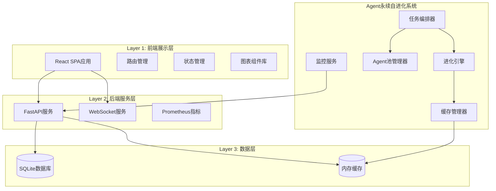
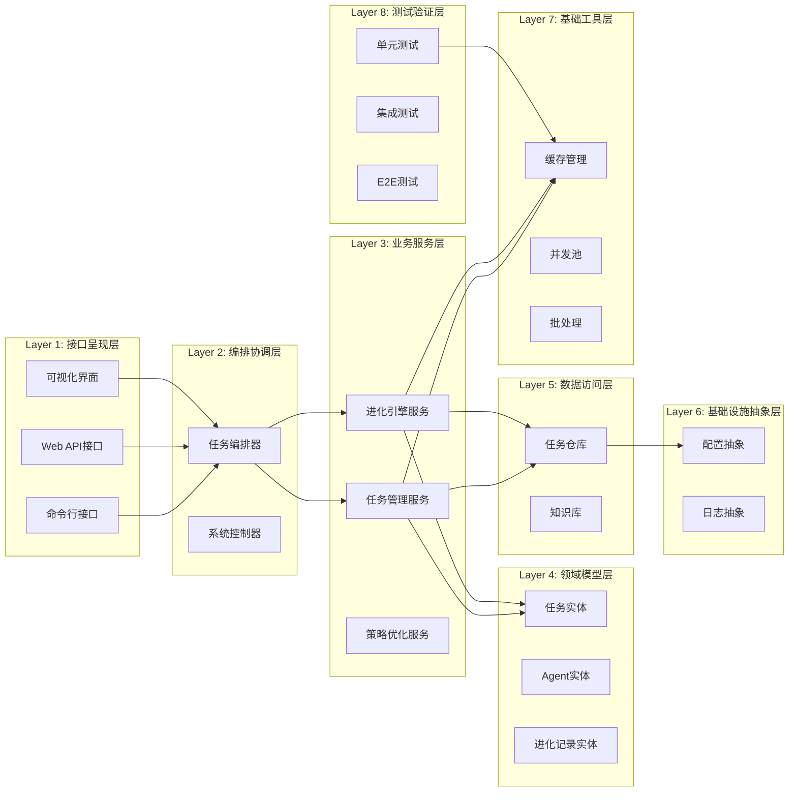
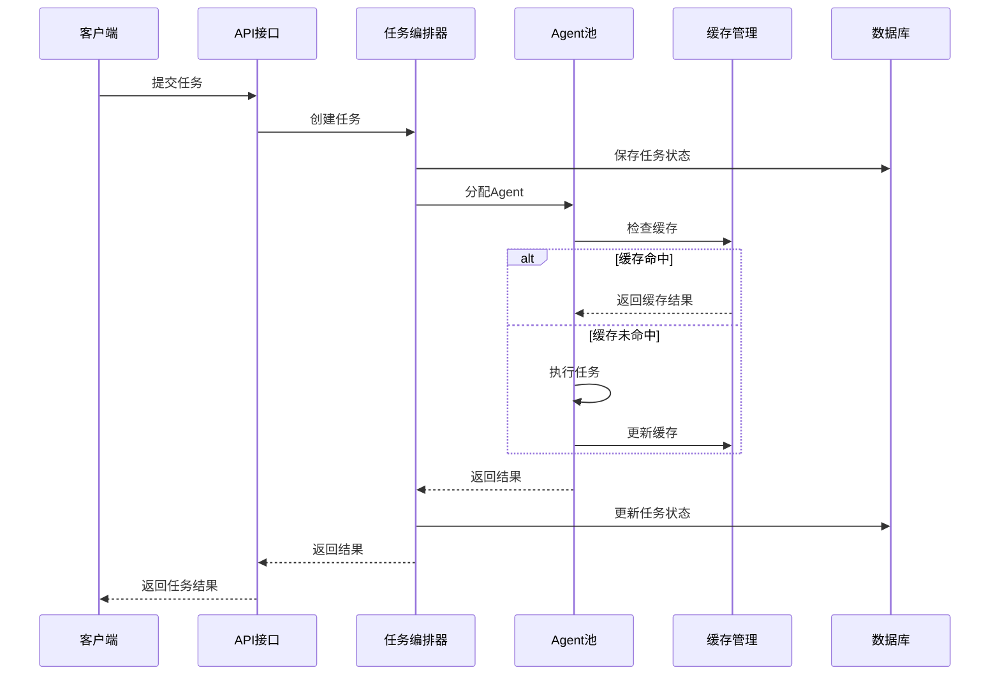
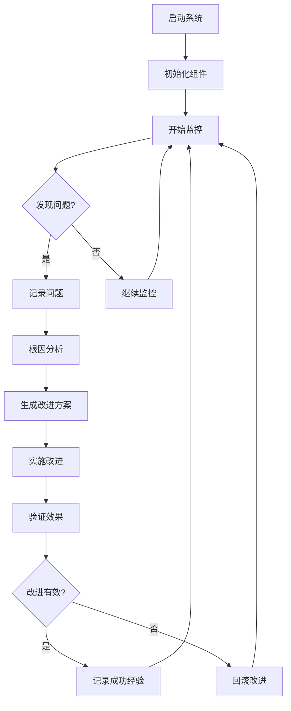
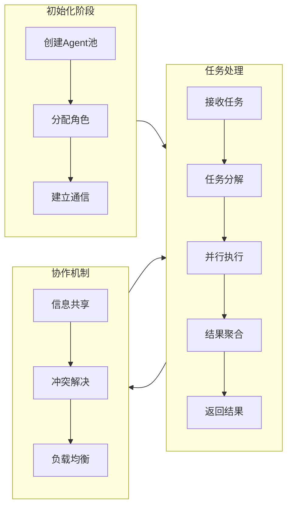
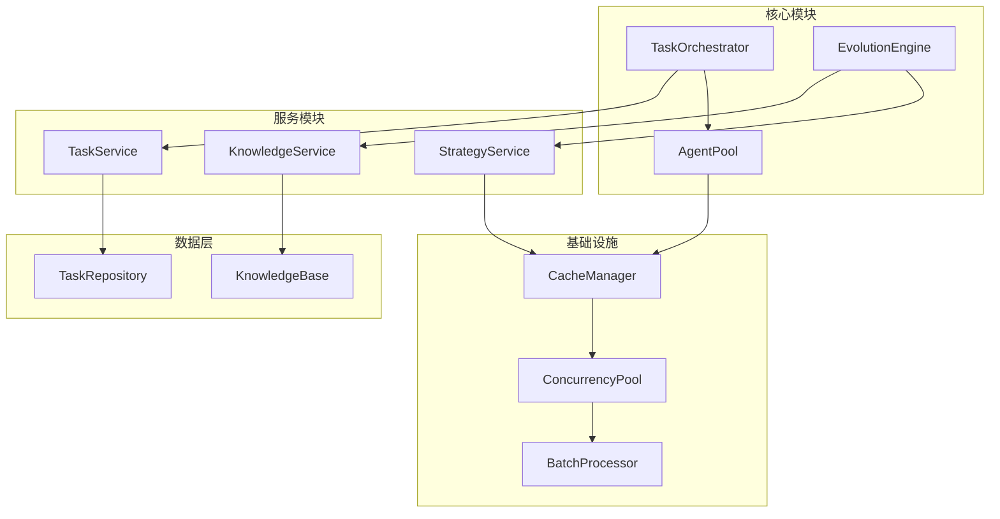

# Agent永续自进化系统可视化平台 - 技术架构文档

## 1. 系统架构概览

### 1.1 整体架构图



---

## 2. 前端架构设计

### 2.1 技术栈

| 技术 | 用途 | 版本 |
|------|------|------|
| React 18 | UI框架 | 18.2.0 |
| TypeScript | 类型系统 | 5.0+ |
| Vite | 构建工具 | 5.0+ |
| React Router | 路由管理 | v6 |
| Chart.js | 图表库 | 4.0+ |
| Mermaid | 流程图 | 10.0+ |
| Tailwind CSS | 样式框架 | 3.0+ |
| Lucide React | 图标库 | 最新版 |

### 2.2 目录结构

```
frontend/
├── src/
│   ├── components/          # 通用组件
│   │   ├── Layout/         # 布局组件
│   │   ├── Charts/          # 图表组件
│   │   ├── Diagrams/        # 流程图组件
│   │   └── UI/              # UI基础组件
│   ├── pages/               # 页面组件
│   │   ├── Home/            # 首页仪表盘
│   │   ├── Architecture/    # 架构图页面
│   │   ├── Flowcharts/      # 流程图页面
│   │   ├── Sequence/        # 时序图页面
│   │   ├── Modules/         # 模块图页面
│   │   └── Documentation/   # 文档中心
│   ├── hooks/               # 自定义Hooks
│   ├── services/            # API服务
│   ├── utils/               # 工具函数
│   └── styles/              # 全局样式
├── public/
└── package.json
```

### 2.3 核心组件设计

#### 2.3.1 架构图组件 (ArchitectureDiagram)

```typescript
interface ArchitectureDiagramProps {
  layers: LayerData[];
  onLayerClick?: (layerId: string) => void;
  showDetails?: boolean;
}

interface LayerData {
  id: string;
  name: string;
  description: string;
  components: ComponentData[];
  dependencies: string[];
}
```

**功能**：
- 展示8层架构的层次结构
- 支持点击展开查看详细组件
- 显示层与层之间的依赖关系
- 支持缩放和平移

#### 2.3.2 流程图组件 (FlowchartViewer)

```typescript
interface FlowchartViewerProps {
  type: 'task' | 'evolution' | 'multi-agent';
  mermaidCode?: string;
  interactive?: boolean;
}
```

**功能**：
- 使用Mermaid渲染流程图
- 支持多种流程图类型
- 交互式节点点击
- 导出为图片

#### 2.3.3 时序图组件 (SequenceDiagram)

```typescript
interface SequenceDiagramProps {
  participants: string[];
  interactions: Interaction[];
  showTimestamps?: boolean;
}
```

**功能**：
- 展示系统交互的时序关系
- 支持消息、响应、同步/异步
- 时间戳显示
- 循环和条件分支

#### 2.3.4 模块依赖图组件 (ModuleDependencyGraph)

```typescript
interface ModuleDependencyGraphProps {
  modules: ModuleData[];
  layout?: 'tree' | 'radial' | 'force';
  onNodeClick?: (moduleId: string) => void;
}
```

**功能**：
- 树状或网状展示模块依赖
- 支持多种布局算法
- 交互式节点操作
- 模块详情弹窗

---

## 3. 后端架构设计

### 3.1 技术栈

| 技术 | 用途 | 版本 |
|------|------|------|
| FastAPI | Web框架 | 0.100+ |
| Pydantic | 数据验证 | 2.0+ |
| SQLite | 数据库 | 3.x |
| Prometheus Client | 指标收集 | 0.17+ |
| Uvicorn | ASGI服务器 | 0.23+ |
| WebSocket | 实时通信 | 内置 |

### 3.2 API设计

#### 3.2.1 RESTful API

| 端点 | 方法 | 描述 |
|------|------|------|
| `/api/v1/system/status` | GET | 获取系统状态 |
| `/api/v1/system/metrics` | GET | 获取系统指标 |
| `/api/v1/tasks` | GET | 列出任务 |
| `/api/v1/tasks/{id}` | GET | 获取任务详情 |
| `/api/v1/evolution/dashboard` | GET | 进化仪表盘数据 |
| `/api/v1/memory/status` | GET | 内存状态 |
| `/api/v1/health` | GET | 健康检查 |

#### 3.2.2 WebSocket API

| 端点 | 描述 | 推送频率 |
|------|------|----------|
| `/api/v1/ws/dashboard` | 仪表盘实时数据 | 2秒 |
| `/api/v1/ws/metrics` | 系统指标实时数据 | 1秒 |

#### 3.2.3 Prometheus端点

| 端点 | 描述 |
|------|------|
| `/metrics` | Prometheus格式指标 |

### 3.3 数据模型

#### 3.3.1 系统状态

```python
class SystemStatus(BaseModel):
    timestamp: datetime
    system_state: SystemState
    evolution_stage: EvolutionStage
    uptime_seconds: float
    health_status: bool
    version: str
```

#### 3.3.2 系统指标

```python
class SystemMetrics(BaseModel):
    timestamp: datetime
    cpu_percent: float
    memory_mb: MemoryInfo
    tasks_total: int
    tasks_by_status: Dict[str, int]
    uptime_seconds: float
```

#### 3.3.3 进化仪表盘

```python
class EvolutionDashboard(BaseModel):
    timestamp: datetime
    stage: str
    memory: MemoryStats
    patterns: PatternStats
    evolution: EvolutionStats
```

---

## 4. 8层架构详解

### 4.1 架构层次



### 4.2 各层职责

#### Layer 1: 接口呈现层
- **职责**：提供多种接入方式
- **组件**：
  - 命令行接口（CLI）
  - RESTful API
  - WebSocket接口
- **技术**：FastAPI、CLI框架

#### Layer 2: 编排协调层
- **职责**：协调任务执行和系统组件
- **组件**：
  - 任务编排器（Orchestrator）
  - 系统控制器（Controller）
- **技术**：异步任务队列、事件驱动

#### Layer 3: 业务服务层
- **职责**：实现核心业务逻辑
- **组件**：
  - 任务管理服务
  - 进化引擎控制器
  - 知识学习服务
  - 策略优化服务
- **技术**：业务规则引擎、优化算法

#### Layer 4: 领域模型层
- **职责**：定义核心业务实体
- **组件**：
  - 任务实体（Task）
  - Agent实体（Agent）
  - 进化记录实体（EvolutionRecord）
- **技术**：Pydantic模型、枚举类型

#### Layer 5: 数据访问层
- **职责**：数据持久化和查询
- **组件**：
  - 任务仓库（TaskRepository）
  - 知识库（KnowledgeBase）
- **技术**：SQLAlchemy ORM、SQLite

#### Layer 6: 基础设施抽象层
- **职责**：提供基础设施抽象
- **组件**：
  - 配置管理抽象
  - 日志系统抽象
- **技术**：配置中心、结构化日志

#### Layer 7: 基础工具层
- **职责**：提供基础工具支持
- **组件**：
  - 缓存管理器（LRU/LFU）
  - 并发任务池
  - 批处理管理器
  - 依赖注入容器
- **技术**：异步编程、连接池

#### Layer 8: 测试验证层
- **职责**：保证系统质量
- **组件**：
  - 单元测试
  - 集成测试
  - E2E测试
  - 混沌工程测试
- **技术**：pytest、模拟测试

---

## 5. 核心流程设计

### 5.1 任务执行流程



### 5.2 进化循环流程



### 5.3 多Agent协作流程



---

## 6. 模块依赖关系



---

## 7. 技术指标

### 7.1 性能指标

| 指标 | 目标值 | 测量方法 |
|------|--------|----------|
| API响应时间 | P99 < 100ms | APM工具 |
| 并发处理能力 | 1000 QPS | 压力测试 |
| 内存使用 | < 512MB | 监控告警 |
| CPU使用率 | < 70% | 系统监控 |

### 7.2 可用性指标

| 指标 | 目标值 | 说明 |
|------|--------|------|
| 系统可用性 | 99.9% | 正常运行时间 |
| 故障恢复时间 | < 30秒 | MTTR |
| 数据持久化 | 100% | 备份验证 |

### 7.3 监控指标

| 指标 | 类型 | 说明 |
|------|------|------|
| `http_requests_total` | Counter | HTTP请求总数 |
| `http_request_duration_seconds` | Histogram | HTTP请求延迟 |
| `agent_tasks_submitted_total` | Counter | 任务提交总数 |
| `agent_tasks_completed_total` | Counter | 任务完成总数 |
| `agent_tasks_in_progress` | Gauge | 正在执行的任务数 |
| `agent_system_uptime_seconds` | Gauge | 系统运行时间 |
| `agent_cpu_usage_percent` | Gauge | CPU使用率 |
| `agent_memory_usage_bytes` | Gauge | 内存使用量 |

---

## 8. 部署架构

### 8.1 开发环境

```
┌─────────────────────────────────┐
│        开发机器                  │
│  ┌─────────┐    ┌─────────┐   │
│  │ 前端    │    │ 后端    │   │
│  │ Vite    │    │ FastAPI │   │
│  │ :5173   │    │ :8000   │   │
│  └─────────┘    └─────────┘   │
│         │           │          │
│         └─────┬────┘          │
│               ▼               │
│        SQLite数据库            │
└─────────────────────────────────┘
```

### 8.2 生产环境

```
┌─────────────────────────────────────────┐
│           Load Balancer                  │
│         (Nginx/HAProxy)                 │
└──────────────┬──────────────────────────┘
               │
    ┌──────────┼──────────┐
    │          │          │
    ▼          ▼          ▼
┌───────┐ ┌───────┐ ┌───────┐
│Node 1 │ │Node 2 │ │Node 3 │
│前端+后端│ │前端+后端│ │前端+后端│
└───┬───┘ └───┬───┘ └───┬───┘
    │          │          │
    └──────────┼──────────┘
               ▼
        ┌──────────┐
        │ PostgreSQL│
        │  主从复制  │
        └──────────┘
```

---

## 9. 安全设计

### 9.1 认证授权
- API Key认证
- JWT Token（可选）
- 权限分级控制

### 9.2 数据安全
- 敏感数据加密存储
- 日志脱敏处理
- 数据库备份加密

### 9.3 网络安全
- CORS配置
- 请求限流
- SQL注入防护

---

## 10. 扩展性设计

### 10.1 水平扩展
- 无状态服务设计
- 会话外置（Redis）
- 负载均衡支持

### 10.2 功能扩展
- 插件化架构
- Webhook支持
- 自定义指标

### 10.3 存储扩展
- 支持多种数据库
- 缓存策略可配置
- 分库分表支持

---

## 11. 运维支持

### 11.1 日志管理
- 结构化日志输出
- 日志级别可配置
- 日志聚合支持（ELK）

### 11.2 监控告警
- Prometheus指标收集
- Grafana可视化
- AlertManager告警

### 11.3 持续部署
- Docker容器化
- K8s编排支持
- CI/CD自动化

---

**文档版本**：v1.0  
**创建日期**：2026-05-17  
**最后更新**：2026-05-17  
**作者**：Agent永续自进化系统团队
